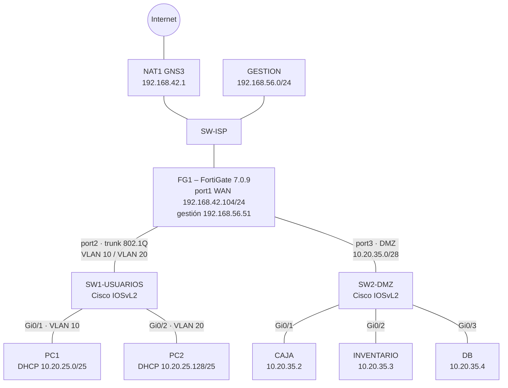

# P3 – Infraestructura 1: FortiGate con DMZ y VLAN segmentadas

**Estudiante:** Gregorys Morel Duluc · **Matrícula:** 2025-0035 · **Materia:** Seguridad de Redes (ITLA)

## 🎥 Video demostrativo

**[▶ Ver video en YouTube](https://youtu.be/TvbM4R-1TO8)**

---

## 1. Propósito del laboratorio

El propósito de este laboratorio es diseñar y demostrar una red segmentada con un FortiGate como único punto de control, en la que los servidores críticos del negocio (Sistema de Caja, Sistema de Inventario y Base de Datos) se aíslan en una **DMZ** separada de las redes de usuarios. Se aplica el principio de **mínimo privilegio**: cada red solo puede comunicarse con lo estrictamente necesario. La DMZ no tiene salida libre a Internet (solo al repositorio de actualizaciones de su sistema operativo), no puede iniciar tráfico hacia las redes de usuarios (evita fuga de tráfico hacia la LAN), solo la VLAN 20 puede administrar los servidores por SSH, y la VLAN 10 recibe una página de bloqueo cuando intenta acceder al Sistema de Inventario. Toda la configuración y la demostración del FortiGate se realizó por GUI.

---

## 2. Topología

---

## 3. Direccionamiento (basado en la matrícula 2025-0035)

Se usan los tres bloques de la matrícula: **20**, **25** y **35**.

| Red | Segmento | Gateway (FG1) | Asignación |
|---|---|---|---|
| VLAN 10 – Usuarios | 10.**20**.**25**.0/25 | 10.20.25.1 | DHCP .2 – .126 |
| VLAN 20 – Usuarios | 10.**20**.**25**.128/25 | 10.20.25.129 | DHCP .130 – .254 |
| DMZ – Servidores | 10.**20**.**35**.0/28 | 10.20.35.1 | Estática |
| WAN | 192.168.42.0/24 | 192.168.42.1 | 192.168.42.104 |
| Gestión | 192.168.56.0/24 | — | 192.168.56.51 |

| Servidor | IP | Servicio |
|---|---|---|
| CAJA – Sistema de Caja | 10.20.35.2/28 | HTTP 80, HTTPS 443, SSH 22 |
| INVENTARIO – Sistema de Inventario | 10.20.35.3/28 | HTTP 80, HTTPS 443, SSH 22 |
| DB – Base de Datos | 10.20.35.4/28 | SSH 22 |

---

## 4. Requisitos y evidencia

| # | Requisito del enunciado | Cómo se cumple | Evidencia |
|---|---|---|---|
| 1 | Toda configuración y demostración del FortiGate por GUI | Interfaces, objetos, Web Filter y políticas creados en el GUI | img/01 a img/16 |
| 2 | LAN de servidores en una DMZ | port3 con rol DMZ, red 10.20.35.0/28 | img/03, img/04 |
| 3 | Políticas que eviten fuga de tráfico hacia la LAN | `DMZ-A-VLAN10-BLOQUEO` y `DMZ-A-VLAN20-BLOQUEO` (DENY + log) | img/15, img/16 |
| 4 | DMZ sin Internet abierto; solo endpoints de actualización | `DMZ-ACTUALIZACIONES` solo hacia el FQDN `dl-cdn.alpinelinux.org` (HTTP/HTTPS). `apk update` funciona; ping a 8.8.8.8 bloqueado | img/13, img/20 |
| 5 | Solo la VLAN 20 tiene SSH hacia los servidores | `VLAN20-SSH-SERVIDORES` (ACCEPT) y `VLAN10-SSH-BLOQUEO` (DENY) | img/07, img/08, img/24, img/28 |
| 6 | VLAN 10 restringida al Sistema de Inventario y ve que violó una política | Web Filter `WF-BLOQUEO-INVENTARIO` → página "Web Page Blocked"; HTTPS a Inventario denegado | img/09, img/10, img/23 |
| 7 | 2 switches con VLAN y seguridad básica | Cisco IOSvL2: VLAN, trunk restringido, port-security sticky, BPDU Guard, puertos libres en VLAN 999 apagados, SSH v2 en VTY | img/17, img/19, `configs/` |
| 8 | 3 servidores en /28 (Caja, Inventario, DB) | 10.20.35.2-4/28 | img/05, img/22, img/27, img/28 |
| 9 | 2 redes de usuarios /25 (VLAN 10 y 20) con DHCP | PC1 recibe 10.20.25.2/25 y PC2 10.20.25.130/25 por DHCP | img/21, img/26 |
| 10 | Direccionamiento basado en matrícula | 10.20.25.0/24 y 10.20.35.0/28 | Sección 3 |
| 11 | Traceroute documentado | PC1 → CAJA: 10.20.25.1 → 10.20.35.2 | img/25 |

---

## 5. Configuración del FortiGate (GUI)

### 5.1 Interfaces
| Interfaz | Alias / Rol | IP | Acceso admin | DHCP |
|---|---|---|---|---|
| port1 | WAN / WAN | 192.168.42.104/24 + 192.168.56.51/24 (gestión) | PING, HTTP, HTTPS, SSH | — |
| VLAN10 (port2) | LAN | 10.20.25.1/25 | PING | .2 – .126 |
| VLAN20 (port2) | LAN | 10.20.25.129/25 | PING | .130 – .254 |
| port3 | DMZ / DMZ | 10.20.35.1/28 | PING | — |

| VLAN 10 | VLAN 20 |
|---|---|
|  |  |

| DMZ (port3) | WAN (port1) |
|---|---|
|  |  |

### 5.2 Objetos de dirección
| Nombre | Tipo | Valor |
|---|---|---|
| SRV-CAJA | Subnet | 10.20.35.2/32 |
| SRV-INVENTARIO | Subnet | 10.20.35.3/32 |
| SRV-DB | Subnet | 10.20.35.4/32 |
| ALPINE-REPO | FQDN | dl-cdn.alpinelinux.org |

### 5.3 Web Filter
`WF-BLOQUEO-INVENTARIO`: Static URL Filter → `10.20.35.3`, tipo Simple, acción **Block**.

### 5.4 Políticas de firewall
| Política | Origen → Destino | Servicio | Acción | Propósito |
|---|---|---|---|---|
| VLAN20-SSH-SERVIDORES | VLAN20 → CAJA, INVENTARIO, DB | SSH | ACCEPT | Solo la VLAN 20 administra servidores |
| VLAN10-SSH-BLOQUEO | VLAN10 → CAJA, INVENTARIO, DB | SSH | DENY + log | Bloqueo explícito de SSH |
| VLAN10-INVENTARIO-WEBFILTER | VLAN10 → INVENTARIO | HTTP | ACCEPT + Web Filter | Muestra la página de bloqueo |
| VLAN10-WEB-CAJA | VLAN10 → CAJA | HTTP, HTTPS, PING | ACCEPT | Uso normal de Caja (PING para traceroute) |
| VLAN20-WEB-SERVIDORES | VLAN20 → CAJA, INVENTARIO | HTTP, HTTPS | ACCEPT | Acceso web completo |
| DMZ-ACTUALIZACIONES | DMZ → ALPINE-REPO | HTTP, HTTPS | ACCEPT + NAT | Único destino de Internet de la DMZ |
| DMZ-A-VLAN10-BLOQUEO | DMZ → VLAN10 | ALL | DENY + log | Evita fuga hacia la LAN |
| DMZ-A-VLAN20-BLOQUEO | DMZ → VLAN20 | ALL | DENY + log | Evita fuga hacia la LAN |
| Implicit Deny | todo lo demás | ALL | DENY | Política por defecto |

| | |
|---|---|
|  |  |
|  |  |
|  |  |
|  |  |

---

## 6. Switches Cisco (IOSvL2)

**SW1-USUARIOS:** Gi0/0 trunk 802.1Q hacia FG1 (solo VLAN 10 y 20, `nonegotiate`), Gi0/1 acceso VLAN 10 (PC1), Gi0/2 acceso VLAN 20 (PC2).
**SW2-DMZ:** Gi0/0 uplink a FG1 port3, Gi0/1-3 servidores en VLAN 35.

Seguridad básica aplicada en ambos:
- Port-security (1 MAC, sticky, violación `restrict`)
- PortFast + BPDU Guard en puertos de acceso
- Puertos no usados en VLAN 999 y en `shutdown`
- `enable secret`, `service password-encryption`, banner
- VTY solo por **SSH v2** con usuario local

Running-configs completos en [`configs/`](configs/).

---

## 7. Pruebas

| Prueba | Resultado | Imagen |
|---|---|---|
| PC1 obtiene IP por DHCP en VLAN 10 | 10.20.25.2/25 desde 10.20.25.1 |  |
| PC1 accede a Caja | Página "Sistema de Caja" |  |
| PC1 intenta Inventario | **Web Page Blocked – Local URLfilter Block** |  |
| PC1 intenta SSH | Timeout – bloqueado |  |
| Traceroute PC1 → CAJA | 1: 10.20.25.1 · 2: 10.20.35.2 |  |
| PC2 obtiene IP por DHCP en VLAN 20 | 10.20.25.130/25 desde 10.20.25.129 |  |
| PC2 accede a Inventario | Página "Sistema de Inventario" |  |
| PC2 entra por SSH a DB | Sesión `DB:~#` |  |
| CAJA actualiza paquetes | `apk update` OK (28651 paquetes) |  |
| CAJA hacia Internet general | Ping a 8.8.8.8 bloqueado |  |

---

## 8. Scripts y configuraciones

| Archivo | Contenido |
|---|---|
| `configs/FG1-P3-Infra1.conf` | Running-config (backup) del FortiGate |
| `configs/SW1-USUARIOS.txt` | Running-config del switch de usuarios |
| `configs/SW2-DMZ.txt` | Running-config del switch de la DMZ |
| `scripts/red-servidores.txt` | Configuración de red de CAJA, INVENTARIO y DB |
| `scripts/servidor-web.sh` | Publica la página de cada sistema por HTTP en nginx |
| `scripts/pruebas.sh` | Comandos de prueba usados en la demostración |

---

## 9. Notas técnicas

- **Imagen:** FortiGate-VM 7.0.9 (evaluación de 15 días). La evaluación usa cifrado bajo y no permite gestión por HTTPS, por eso el GUI se usa por HTTP en la red de gestión aislada.
- **Memoria:** con 1 GB el FortiGate llegó al 84 % de RAM, se reinició solo y dejó de reenviar tráfico. Se asignaron 2 GB (máximo de la licencia) y el reenvío funcionó.
- **DNS de la DMZ:** la red local bloquea consultas DNS directas a servidores externos. Los servidores usan al FortiGate (10.20.35.1) como DNS, y el FortiGate resuelve a través del NAT. Así la DMZ no habla con ningún DNS de Internet. Esta función (`system dns-server`) y la IP inicial de gestión se configuraron por consola, porque son pasos previos a tener acceso al GUI.
